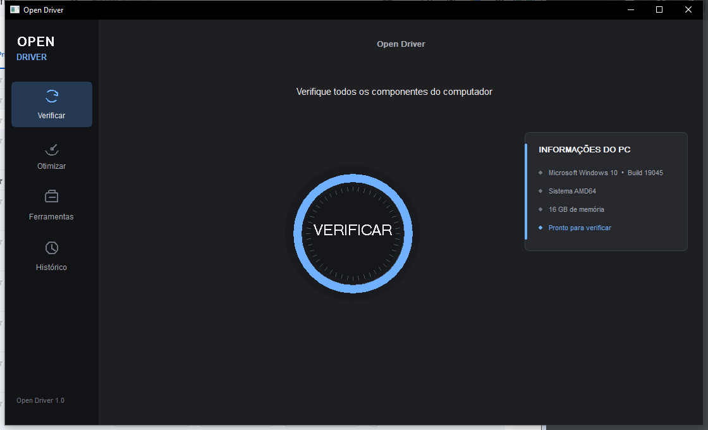

# Open Driver

Atualizador de drivers gratuito e open source para Windows 10 e 11, com descoberta completa, validação antes da oferta, download autorizado, instalação transacional e rollback.



## Estado do projeto

Versão atual pronta para testes no Windows. A interface Qt Quick/QML está integrada ao núcleo C++20: ela verifica os dispositivos em segundo plano, permite cancelar a busca de verdade, exibe somente candidatos aprovados pela validação final e instala apenas após confirmação.

O projeto não mantém uma lista fixa de versões de drivers. Os candidatos são consultados em tempo de execução no Windows Update, Microsoft Update Catalog e fontes oficiais compatíveis, portanto novas versões podem aparecer sem exigir uma atualização diária do aplicativo.

### Destaques

- inventário real de hardware com SetupAPI e CfgMgr32;
- descoberta pelo Windows Update e Microsoft Update Catalog;
- validação de Hardware ID, arquitetura, versão, data, hash e assinatura;
- interface premium escura em Qt 6 Quick/QML, responsiva e animada;
- cancelamento cooperativo da verificação, inclusive da consulta ao Windows Update;
- aprovação separada para baixar e para instalar;
- plano transacional, diário de operações, verificação pós-instalação e rollback;
- 12 testes automatizados cobrindo inventário, ranking, validação, planos e execução.

> O Open Driver é um projeto independente e não possui vínculo com a IObit ou com o Driver Booster.

## Módulos atuais

- `DeviceInventory`: enumera dispositivos com SetupAPI/CfgMgr32 sem alterar seu estado; coleta Instance ID, Hardware IDs, Compatible IDs, classe, fabricante, localização, status e metadados do driver instalado.
- `LocalDriverStoreSource`: pede ao SetupAPI a lista `SPDIT_COMPATDRIVER` de cada dispositivo e extrai rank, INF, seção, fornecedor, data, versão, IDs do modelo e flags de assinatura.
- `ExternalPackageSource`: restringe a busca a um INF informado com `DI_ENUMSINGLEINF`, permitindo avaliar um pacote antes de publicá-lo no Driver Store.
- `WindowsUpdateSource`: consulta o Windows Update Agent em modo de busca e recupera metadados de atualizações de driver disponíveis.
- `OfficialDriverSource`: cruza Hardware IDs presentes com pacotes oficiais do fabricante do PC, Intel, Dell, HP e ASUS; um mesmo pacote pode atender vários controladores e só vira oferta depois da leitura do INF e da assinatura.
- `MicrosoftCatalogSource`: pesquisa o Microsoft Update Catalog e recupera URLs e hashes SHA-256 publicados para um item selecionado.
- `CatalogResolver`: abre os detalhes de cada resultado, rejeita Hardware ID ou arquitetura incompatíveis e pontua título, idioma, data, fornecedor e modelo; empate não produz seleção.
- `PackageMaterializer`: baixa em diretório novo, confere SHA-256 antes de extrair, bloqueia caminhos de CAB inseguros, valida o catálogo Authenticode e localiza os INFs.
- `CandidateRanker`: classifica candidatos já avaliados pelo Windows e mantém uma trilha de decisão.
- `RecommendationEngine`: aplica a política final de atualizar, manter, ignorar ou pedir revisão manual usando presença, correspondência, fornecedor, versão, data e verificações do pacote.
- `UpdatePlan`: produz um plano determinístico e não executável com pré-condições, exportação do driver atual, ponto de restauração, instalação prevista, verificação e rollback.
- `TransactionExecutor`: carrega o plano com parser JSON estrito, reobserva o estado e oferece simulação ou aplicação confirmada; grava cada passo em JSONL antes da mudança, usa executáveis oficiais do Windows, verifica o driver instalado e tenta restaurar o pacote exportado quando a instalação não confere.
- `Pipeline`: coordena inventário, ofertas do Windows Update e escolha no Microsoft Update Catalog, deixando pacotes de dispositivos ausentes de lado antes de qualquer download.
- `open_driver_scan`: CLI que grava o inventário em JSON UTF-8.
- `open_driver_candidates`: CLI que descobre candidatos locais, calcula SHA-256 dos INFs e grava a classificação em JSON.
- `open_driver_external_inf`: CLI que confronta um INF arbitrário com um dispositivo ou com o inventário presente.
- `open_driver_windows_update`: CLI que pesquisa atualizações de driver e relaciona Hardware IDs ao inventário presente e histórico.
- `open_driver_package`: CLI que pesquisa o catálogo, gera manifesto ou materializa um item e encaminha os INFs extraídos ao `ExternalPackageSource`.
- `open_driver_catalog_resolver`: CLI que recebe uma oferta WUA ou seus metadados e escolhe um `catalog_update_id` somente quando existe um vencedor inequívoco.
- `open_driver_recommendation`: CLI que confronta o melhor candidato de um INF com o estado instalado e grava a decisão e sua trilha em JSON.
- `open_driver_update_plan`: CLI que revalida CAB, catálogo, INF, dispositivo e recomendação antes de emitir um plano; decisões diferentes de `update` geram um plano bloqueado sem comandos.
- `open_driver_transaction`: CLI em `dry-run` por padrão; o modo real exige `--apply --confirm <plan_id>`.
- `open_driver_pipeline`: CLI coordenadora somente leitura; produz um relatório simples com o ponto alcançado por cada oferta e sempre informa `system_changes=0`.
- `open_driver_gui`: interface Qt 6 Quick/QML com navegação, animações, histórico e configurações reais; verifica em segundo plano, pede autorização antes de baixar, valida os pacotes e instala apenas as linhas selecionadas após uma segunda confirmação.

O coletor futuro deve fornecer `windows_rank`, aplicabilidade de arquitetura/sistema operacional e validação real da assinatura. Este núcleo não tenta adivinhar esses valores a partir de metadados remotos.

```powershell
cmake -S . -B build
cmake --build build --config Release
ctest --test-dir build -C Release --output-on-failure
```

Com Visual Studio Build Tools instalado, `build-tests.cmd` compila e executa o teste diretamente.

```powershell
.\build\open_driver_scan.exe --output device-inventory.json
.\build\open_driver_candidates.exe --limit 20 --output local-candidates.json
.\build\open_driver_external_inf.exe --inf C:\pacotes\driver.inf --output external-analysis.json
.\build\open_driver_windows_update.exe --output windows-update-drivers.json
.\build\open_driver_package.exe --search "nome exato da atualização" --report catalog-search.json
.\build\open_driver_package.exe --catalog-id <guid> --manifest-only --report catalog-manifest.json
.\build\open_driver_package.exe --catalog-id <guid> --output-dir C:\pacotes\<guid> --device "PCI\\VEN_..." --report package-analysis.json
.\build\open_driver_package.exe --catalog-id <guid> --download-html catalog-response.html --source-dir C:\cache --output-dir C:\pacotes\<guid> --device "PCI\\VEN_..." --report package-analysis.json
.\build\open_driver_catalog_resolver.exe --wua-update-id <guid> --output catalog-resolution.json
.\build\open_driver_recommendation.exe --inf C:\pacotes\driver.inf --instance "PCI\\VEN_..." --output recommendation.json
.\build\open_driver_update_plan.exe --inf C:\pacotes\driver.inf --instance "PCI\\VEN_..." --catalog-id <guid> --cab C:\pacotes\driver.cab --cab-sha256 <base64> --catalog C:\pacotes\driver.cat --rollback-dir C:\rollback\plano --output update-plan.json
.\build\open_driver_transaction.exe --plan update-plan.json --journal transaction.jsonl
.\build\open_driver_transaction.exe --plan update-plan.json --journal apply.jsonl --apply --confirm <plan_id>
.\build\open_driver_pipeline.exe --output pipeline-report.json
.\build\open_driver_gui.exe
```

Use `--all` para incluir dispositivos ausentes/antigos registrados no sistema. O padrão enumera somente dispositivos presentes.

Ordem aplicada:

1. rejeita arquitetura, alvo do sistema ou assinatura inválidos;
2. rank do Windows crescente;
3. data do INF decrescente;
4. versão do INF decrescente;
5. hash e identificador do pacote para desempate reproduzível.

Cada candidato aceito ou rejeitado carrega sua trilha de decisão.

O rank vem de `SetupDiGetDriverInstallParams`, e pacotes marcados com `DNF_BAD_DRIVER` são rejeitados. `DNF_INF_IS_SIGNED` aceita os estados reconhecidos pelo Windows, incluindo pacote WHQL, inbox ou Authenticode.

O caminho externo só abre o INF para construir nós compatíveis. Ele não chama APIs de cópia, publicação ou instalação de drivers.

O Windows Update Agent fornece identidade, título, Hardware ID, fornecedor, modelo e data. Quando `DownloadContents` não publica URLs, o título exato alimenta a pesquisa no Microsoft Update Catalog. O resolvedor seleciona automaticamente um vencedor inequívoco e mantém empates explícitos. O manifesto expõe o SHA-256 oficial; a materialização recusa arquivo divergente e diretório de destino já existente. Nenhuma dessas rotas publica ou instala o driver.

### Transporte OpenSSL para o catálogo

O caminho de rede padrão tenta WinHTTP e WinINet. Em máquinas onde a camada de segurança do Windows não consegue abrir o catálogo, o build opcional acrescenta um terceiro caminho com libcurl e OpenSSL. Ele mantém a verificação do certificado ligada e carrega os certificados confiáveis do Windows diretamente na memória.

Execute a partir da pasta `open-driver-core`:

```powershell
python .\tools\bootstrap_vcpkg.py
python .\tools\vcpkg_install_with_python_fetch.py
$workspace = (Resolve-Path ..).Path
cmake -S . -B build-openssl -A x64 `
  -DOPEN_DRIVER_ENABLE_CURL_OPENSSL=ON `
  -DCMAKE_TOOLCHAIN_FILE="$workspace/work/vcpkg-src/scripts/buildsystems/vcpkg.cmake" `
  -DVCPKG_MANIFEST_INSTALL=OFF `
  -DVCPKG_INSTALLED_DIR="$workspace/work/vcpkg-installed" `
  -DVCPKG_TARGET_TRIPLET=x64-windows-static-md `
  -DCMAKE_PREFIX_PATH="$workspace/work/vcpkg-installed/x64-windows-static-md"
cmake --build build-openssl --config Release --parallel
ctest --test-dir build-openssl -C Release --output-on-failure
```

As dependências e os arquivos baixados pelo `vcpkg` ficam em `work`, fora do código-fonte. O script auxiliar usa o Python apenas para baixar arquivos quando o próprio `vcpkg` encontra o erro TLS desta máquina; hashes e receitas continuam sendo conferidos pelo `vcpkg` antes da compilação.

O resolvedor aplica Hardware ID e arquitetura como requisitos. Idioma, título, data, fornecedor e modelo formam a pontuação auditável. Se dois itens elegíveis terminarem com a mesma pontuação máxima, `selected_catalog_update_id` fica vazio e `ambiguous=true`.

O motor de recomendação ignora dispositivos ausentes, pacotes com hash ou assinatura inválidos e candidatos não aplicáveis. Mantém a versão instalada quando o candidato é igual ou inferior; diferenças de fornecedor, regressões de data e resultados ambíguos exigem revisão, exceto quando um driver de fornecedor com Hardware ID exato substitui uma associação genérica por Compatible ID sem regredir a data.

O `UpdatePlan` não executa seus comandos. Um plano só fica `ready=true` para dispositivo presente, recomendação `update`, Hardware ID exato, CAB e INF com hashes coincidentes, catálogo válido e driver instalado exportável. O `plan_id` muda quando qualquer identidade ou hash relevante muda.

O executor continua em `dry-run` quando `--apply` não é informado. Nos dois modos ele recusa planos bloqueados, mudanças no driver instalado, hashes diferentes, catálogo inválido, alteração de Hardware ID ou rank, recomendação recalculada diferente de `update`, mudança na ordem dos passos e qualquer argumento fora do formato criado pelo planejador.

O modo real exige privilégios de administrador e a repetição exata do `plan_id`. Ele resolve `pnputil.exe` e `powershell.exe` somente nas pastas oficiais do Windows, cria ou aceita apenas uma pasta de rollback vazia, confirma que o INF antigo foi exportado, grava o evento `starting` antes de cada comando e limita cada processo a cinco minutos. Depois da instalação, ele exige que fornecedor, versão e data correspondam ao candidato. Se não corresponderem, reinstala o INF exportado e confirma se o estado original voltou. O diário JSONL permite saber até onde a transação chegou mesmo após uma interrupção.

A interface cobre inventário completo, Windows Update e fontes oficiais de fabricantes. Dispositivos desconectados, reinstalações sem defeito e componentes de jogos que são runtimes (Java, OpenAL, Visual C++ e XNA) não entram na contagem de drivers desatualizados. O download só começa após autorização; a instalação exige confirmação separada e usa o executor transacional com verificação e rollback.

## Licença

Distribuído sob a licença MIT. Consulte [LICENSE](LICENSE). As dependências mantêm suas próprias licenças, descritas em [THIRD_PARTY_NOTICES.md](THIRD_PARTY_NOTICES.md).
